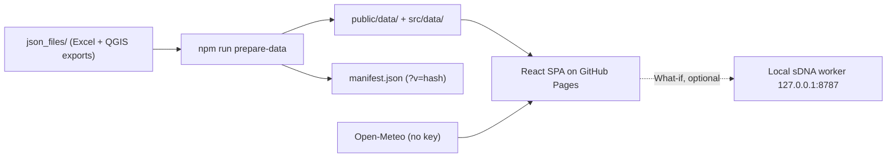

<div align="center">

<!-- TODO: add docs/assets/banner.png -->

# 🏙️ Mount Lavinia Urban Analytics Dashboard

**Maps, KPIs, and planning evidence for the Galle Road corridor in Mount Lavinia, Sri Lanka, in one browser tab.**

[](package.json)
[](vite.config.js)
[](package.json)
[](tailwind.config.js)
[](https://github.com/BronXTJ/mount-lavinia-dashboard/actions/workflows/ci.yml)
[](LICENSE)

[**Live demo**](https://bronxtj.github.io/mount-lavinia-dashboard/) · [**Architecture**](ARCHITECTURE.md) · [**Runbook**](docs/RUNBOOK.md) · [**Changelog**](CHANGELOG.md)

</div>

---

## Contents

- [Why](#-why)
- [Highlights](#-highlights)
- [Screenshots](#️-screenshots)
- [How it works](#-how-it-works)
- [Architecture](#️-architecture)
- [Getting started](#-getting-started)
- [Testing](#-testing)
- [Repository layout](#️-repository-layout)
- [Data and sources](#️-data-and-sources)
- [Documentation](#-documentation)
- [Limitations](#-limitations)
- [Author](#-author)
- [Licence](#-licence)

---

## 🧭 Why

Studio evidence for the Galle Road corridor usually sits across QGIS projects, spreadsheets, and slides. This dashboard puts it on one page. The study area is five Grama Niladhari (GN) divisions: Mount Lavinia, Kawdana West, Watarappala, Wathumulla, and Wedikanda. It supports studio work, presentations, and discussion of problems and potentials.

---

## ✨ Highlights

| | Section | What it shows |
|---|---|---|
| 📈 | **Overview** | KPIs, GN selection, population structure, land-use mix, map, live weather and air quality from Open-Meteo |
| 🕸️ | **Focus Area · Centrality** | Closeness and betweenness at 500 / 2000 / 3000 / 5000 m; What-if sketch and option compare |
| 🏢 | **Focus Area · Density** | Hex-grid FSI, GSI, OSR, typology, land-use mix |
| 🌱 | **Focus Area · Urban Maturation** | UMI, Shannon entropy, accessibility |
| 🚶 | **Focus Area · Walk Accessibility** | Access score, tier, walk time by destination group |
| 🛣️ | **Focus Area · Network Form** | 4-way / 3-way / cul-de-sac typology, stub depth |
| 🚗 | **Movement & Behaviour** | Junction volumes, pedestrian flows, vehicle mix, day and time filters |
| 🌿 | **Land Cover Change** | Landsat 30 m (~2000 / ~2015 / ~2025) and Sentinel-2 10 m per-GN metrics |
| 🌡️ | **Environmental** | 10 m grid UTCI, UHI, air temperature, Tmrt, shadow, sky view factor |
| 🔗 | **Synthesis** | Story spine, relationships graph, finding catalogue |
| ⚖️ | **Issues & Potentials** | SWOT, PESTEL, SFA-style assessment |
| 🗺️ | **Export Maps** | Download maps, GeoJSON, and rasters |
| 🧩 | **Land Use** | The route exists; charts are a placeholder ("coming soon") |

Teal **ⓘ** buttons open plain-language notes. A User Guide sits at the bottom of the sidebar. Below 1024 px width, map views stack vertically and the sidebar becomes an overlay.

---

## 🖼️ Screenshots

<!-- TODO: add captured images to docs/screenshots/ (overview, centrality, environmental, land cover, synthesis) -->

---

## 🔁 How it works



The browser only reads prepared JSON, GeoJSON, and rasters. Analysis is done offline. What-if is the exception: it needs a local sDNA worker.

---

## 🏗️ Architecture

| Layer | Technology |
|---|---|
| UI | React 19, Vite 8, Tailwind CSS 3, Lucide |
| Routing | React Router 7, lazy-loaded tabs, error boundaries |
| Maps | Leaflet, react-leaflet, geotiff |
| Charts | Recharts, D3 |
| Data client | `src/lib/dataClient.js` (cache, dedupe, abort, `?v=` hash) |
| What-if worker | Python FastAPI + sDNA, pairing token, 10-minute timeout |

More detail: [`ARCHITECTURE.md`](ARCHITECTURE.md).

---

## 🚀 Getting started

### Use it online

Open <https://bronxtj.github.io/mount-lavinia-dashboard/>.

### Run from a clone

Node.js 22 is what CI uses.

```bash
git clone https://github.com/BronXTJ/mount-lavinia-dashboard.git
cd mount-lavinia-dashboard
npm install
npm run dev
```

Open the URL from the terminal (usually `http://localhost:5173/mount-lavinia-dashboard/`).

Optional variables (copy [`.env.example`](.env.example) to `.env.local`):

| Variable | Purpose |
|---|---|
| `VITE_CARTO_API_KEY` | CARTO dark basemap key, baked in at build time |
| `VITE_WHAT_IF_WORKER_TOKEN` | Pre-fills the What-if worker pairing token |

### What-if worker (optional)

```bash
pip install -r scripts/what-if/api/requirements.txt
npm run what-if:worker
```

Open Centrality → What-if, then **Connect**. Without the worker you can still export proposed links as GeoJSON. Details: [`scripts/what-if/README.md`](scripts/what-if/README.md).

### Regenerate data (optional)

```bash
npm run prepare-data   # json_files/ → src/data/ + public/data/ + manifest
npm run data:manifest  # refresh hashes only
```

### Build and deploy

```bash
npm run build
npm run preview
npm run deploy         # gh-pages branch (the live path)
```

> [!NOTE]
> `.github/workflows/deploy.yml` exists, but Pages is served from the `gh-pages` branch. See [`docs/PHASE4_DECISIONS.md`](docs/PHASE4_DECISIONS.md).

---

## 🧪 Testing

| Command | What it covers |
|---|---|
| `npm run lint` | ESLint (React, hooks, jsx-a11y) |
| `npm test` | Vitest unit tests |
| `npm run test:e2e` | Playwright route smoke tests with golden screenshots |
| `npm run format:check` | Prettier |

CI ([`ci.yml`](.github/workflows/ci.yml)) runs lint, test, and build on Ubuntu, and the Playwright suite on Windows, both with Node.js 22.

---

## 🗂️ Repository layout

```text
mount-lavinia-dashboard/
├── public/data/        GeoJSON, rasters, summaries served to the browser
├── public/exports/     Static map images for Export Maps
├── src/
│   ├── tabs/           One file per route
│   ├── components/     Maps, panels, synthesis, issues, land cover, environmental
│   ├── features/       Movement & behaviour module
│   ├── hooks/          Layer loaders
│   ├── lib/            dataClient
│   ├── constants/      Layers, ramps, copy
│   └── data/           JSON from prepare-data
├── scripts/            prepare-data, manifest, What-if worker
├── e2e/  tests/        Playwright and Vitest
├── docs/               RUNBOOK, PHASE4_DECISIONS
└── json_files/         Source GIS and Excel (partly local-only)
```

---

## 🗄️ Data and sources

| Source | Role |
|---|---|
| Studio GIS + `chalani database.xlsx` | Demographics, boundaries, land use |
| `public/data/` | Precomputed centrality, density, maturation, walk access, network form, land cover, environmental grids |
| [Open-Meteo](https://open-meteo.com/) forecast and air quality | Live weather, US AQI, PM2.5 on Overview |
| OpenStreetMap, Esri World Imagery, CARTO | Basemaps |

> [!IMPORTANT]
> Landsat 30 m corridor percentages and Sentinel-2 10 m per-GN percentages are different products; do not mix them. On Sentinel-2 cards, Green is a subset of Soft. GeoJSON exports are WGS 84; the shadow raster is SLD99 (EPSG:5235).

---

## 📚 Documentation

| Document | Description |
|---|---|
| [`ARCHITECTURE.md`](ARCHITECTURE.md) | Runtime shape, data flow, routes |
| [`docs/RUNBOOK.md`](docs/RUNBOOK.md) | What-if token, deploy paths |
| [`docs/PHASE4_DECISIONS.md`](docs/PHASE4_DECISIONS.md) | What shipped and what is deferred |
| [`CHANGELOG.md`](CHANGELOG.md) | 0.1.0 and Unreleased |

---

## ⚠️ Limitations

- **Land Use** is a placeholder page.
- **What-if recompute** needs a local sDNA worker. GitHub Pages cannot host it.
- **Analysis is precomputed.** The dashboard does not re-run GIS models in the browser.
- **Some source data is local-only** (part of `json_files/`, condominium inventory, research folders) and is not published.
- The thermal grid is about 9.7 MB, so the Environmental tab can be slow on first load.
- Unknown routes are served via a `404.html` copy of `index.html`: deep links work but return HTTP 404.

---

## 👤 Author

**Thanuja Lakshan Senarathne**, BSc (Hons) Urban Informatics & Planning, University of Moratuwa
[@BronXTJ](https://github.com/BronXTJ) · [LinkedIn](https://www.linkedin.com/in/thanuja-senarathne-1122a828b) · [Email](mailto:thanujals1781@gmail.com)

The information architecture was sketched on paper first, then built in [Cursor](https://cursor.com/) with AI-assisted coding. Design choices, data interpretation, testing, and final code are the author's responsibility.

---

## 📜 Licence

Code is released under the [MIT License](LICENSE). Copyright (c) 2026 Thanuja Lakshan Senarathne.

Spatial datasets, studio GIS and Excel sources, OpenStreetMap (ODbL), Esri, CARTO, and Open-Meteo keep their owners' terms. Confirm you have rights to any underlying data before reuse.

<div align="center"><sub>Mount Lavinia · Galle Road Corridor · Sri Lanka 🇱🇰</sub></div>
